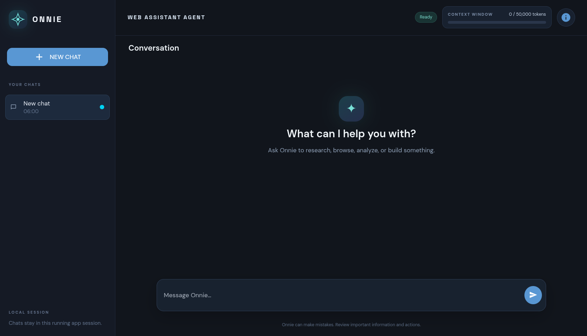
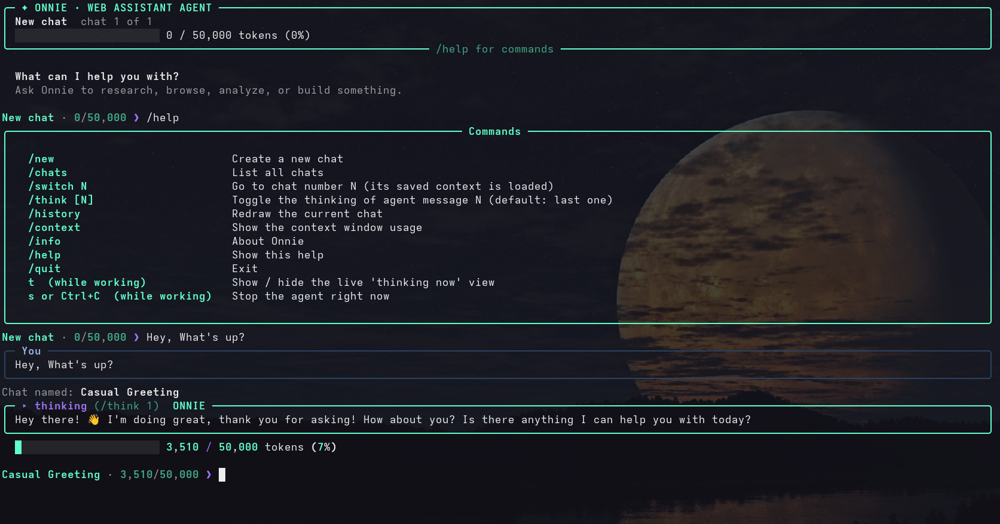

# Onnie — Web Assistant Agent

**GUI**


**CLI**


Onnie is a web-browsing assistant built on [`smolagents`](https://github.com/huggingface/smolagents) (a `CodeAgent`), [LiteLLM](https://github.com/BerriAI/litellm) and [Playwright](https://playwright.dev/python/). You give it a task in plain language; it plans, writes Python code, drives a real Chromium browser and comes back with an answer.

It ships with **two interfaces** that share the same agent core:

| Mode | Command | What you get |
|------|---------|--------------|
| **Visual** (default) | `python main.py` | A dark, responsive web chat UI (NiceGUI) |
| **CLI** | `python main.py -m cli` | A colorful terminal chat (rich) |

---

## What Onnie can do

- **Search the web** (DuckDuckGo) and read the results.
- **Open and read pages**: plain readable text or raw HTML when it needs to inspect elements.
- **Interact with pages**: click links/buttons (by accessibility role + name), fill in forms and inputs (CSS selector), type, press keys, scroll.
- **Take screenshots** and look at them on its next step (most useful with a vision-capable model).
- **Run Python code** it writes itself, limited to a safe list of imports: `requests`, `bs4`, `PIL`, `json`, `datetime`, `re`, `numpy`, `pandas`, `urllib`, `httpx`.
- **Work on several chats at once.** Every chat has its own agent memory; switching chats loads only that chat's context.
- **Show its work.** Each answer can carry a collapsible *Thinking* section (reasoning, code, tool output), and you can watch it live while the agent is running.
- **Be stopped at any time.** The interruption is recorded in the agent's memory so it knows it was interrupted when you continue.
- **Manage its own context window.** A meter shows token usage; when it reaches the threshold, older steps are trimmed automatically and you are warned.
- **Name your chats.** The first message of each chat is summarized by the agent into a short title (max 5 words).

### Browser tools

| Tool | Purpose |
|------|---------|
| `start_browser` / `stop_browser` | Open / close Chromium |
| `search_web` | DuckDuckGo search (title, URL, snippet) |
| `open_page` | Navigate to an HTTP(S) URL |
| `get_page_text_content` | Readable text of the current page |
| `get_page_raw_content` | Full raw HTML of the current page |
| `click_element` | Click by accessibility role and name |
| `fill_input` | Fill an input by CSS selector |
| `keyboard_type` / `keyboard_press` | Type text / press keys (`Enter`, `Control+A`, …) |
| `mouse_scroll` | Scroll horizontally or vertically |
| `take_screenshot` | Save a screenshot to `./images/` and show it to the agent |
| `mouse_move`, `mouse_click`, `mouse_double_click` | Coordinate-based control. **Disabled by default**, enable with `ENABLE_VISION_TOOLS: true` for a capable vision model |

---

## Project structure

```text
onnie/
├── main.py                 # Entry point: parses --mode, prepares config, starts GUI or CLI
├── conf.yml                # All the configurations.
├── requirements.txt        # Pinned dependencies
├── README.md
└── onnie/                  # Application package
    ├── config.py           # Loads/validates conf.yml -> Settings; environment (proxy) setup
    ├── prompts.py          # Static texts: title prompt, stop text, "About Onnie" text
    ├── text_utils.py       # Pure helpers: thinking extraction, chat-title cleanup
    ├── chat.py             # Chat / Message models shared by GUI and CLI (state, isolation, stop, events)
    ├── agent/
    │   ├── factory.py      # Builds the LLM model and one CodeAgent per chat; memory trimming
    │   └── steps.py        # StopStep: how a stop request reaches the model
    ├── tools/
    │   ├── browser.py      # Playwright browser tools (the former tools.py)
    │   └── __init__.py     # Which tools the agent gets (default_tools)
    ├── gui/
    │   ├── app.py          # NiceGUI page: layout, rendering, send/stop logic
    │   ├── theme.py        # Fonts, logo, stylesheet loader
    │   └── theme.css       # The dark/neon stylesheet
    └── cli/
        ├── app.py          # Terminal app: command loop, background run with live keys
        ├── render.py       # All `rich` panels, tables and the context bar
        └── keyreader.py    # Non-blocking single-key input (Linux/macOS/Windows)
```

The idea: **`chat.py` and `agent/` hold the logic, `gui/` and `cli/` only present it.** To change how the agent behaves, edit `agent/` or `config`; to change how it looks, edit `gui/` or `cli/`.

---

## Setup

Requires **Python 3.10+**.

```bash
# 1. Create and activate a virtual environment
python -m venv .venv
source .venv/bin/activate          # Windows: .venv\Scripts\activate

# 2. Install the dependencies (exact versions)
pip install -r requirements.txt

# 3. Install the Chromium build used by Playwright (once)
playwright install chromium


## Using the visual mode

```bash
python main.py            # same as: python main.py -m visual
```

Open **http://127.0.0.1:8080** (or the `HOST`/`PORT` you configured).

- **Chat**: type in the composer at the bottom and press the send button.
- **New chat / switching**: use **New chat** or click any chat in the sidebar. Each chat keeps its own messages, thinking and agent context. You can't switch while a response is running.
- **Thinking**: agent messages that have reasoning show a **Thinking** button; click it to expand/collapse. While the agent is working, **Thinking now…** shows its progress live.
- **Stop**: the send button turns into a red **Stop** button while the agent runs. Press it to interrupt at the next step.
- **Context window**: the top-right card shows `tokens / limit`; the bar turns orange near the threshold, and a warning appears when old history is trimmed.
- **About Onnie**: the ℹ️ button opens the info pop-up.

## Using the CLI mode

```bash
python main.py -m cli
```

Type a message and press Enter to talk to Onnie. Lines starting with `/` are commands:

| Command | Action |
|---------|--------|
| `/new` | Create a new chat |
| `/chats` | List all chats (number, title, time, context usage) |
| `/switch N` | Go to chat number N (its saved context is loaded) |
| `/think [N]` | Expand/collapse the thinking of agent message N (default: the last one) |
| `/history` | Redraw the current chat |
| `/context` | Show context-window usage |
| `/info` | About Onnie |
| `/help` | Show the command list |
| `/quit` | Exit |

While the agent is working (a spinner with a live token counter is shown) you can press, **without Enter**:

| Key | Action |
|-----|--------|
| `t` | Show / hide the live "thinking now" view |
| `s` or `Ctrl+C` | Stop the agent right now |

---

## Notes and limitations

- **Temporary chats.** Chats live in process memory only; they disappear when the app restarts.
- **One shared browser.** Browser state is global in `onnie/tools/browser.py`, so all chats share one Chromium window (agent memories are separate, the browser is not). Chromium opens **visibly** (`headless=False`).
- **Screenshots** are saved to `images/`.
